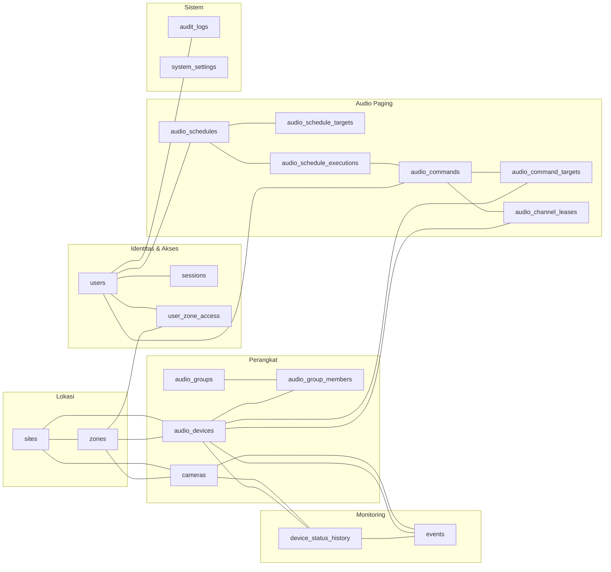

# ERD — CCTV Monitoring & Audio Paging

Sumber kebenaran: [`backend/prisma/schema.prisma`](../../backend/prisma/schema.prisma) dan
[`migration.sql`](../../backend/prisma/migrations/0001_init/migration.sql).
Diagram di bawah dapat dirender oleh GitHub, VS Code (Markdown Preview Mermaid), dan editor Mermaid lainnya.

Legenda: `PK` primary key · `FK` foreign key · `UK` unique · `1--o{` satu-ke-banyak ·
`o|` opsional (nullable). Semua kolom waktu bertipe `timestamptz` (UTC).

## 1. Gambaran per domain

## 2. ERD lengkap

```mermaid
erDiagram
  users ||--o{ sessions : "memiliki"
  users ||--o{ user_zone_access : "diberi akses"
  zones ||--o{ user_zone_access : "diakses oleh"
  sites ||--o{ zones : "memiliki"
  sites ||--o{ cameras : "menaungi"
  sites ||--o{ audio_devices : "menaungi"
  zones |o--o{ cameras : "opsional, site harus sama"
  zones |o--o{ audio_devices : "opsional, site harus sama"
  audio_groups ||--o{ audio_group_members : "beranggota"
  audio_devices ||--o{ audio_group_members : "tergabung"
  cameras |o--o{ device_status_history : "tepat satu perangkat"
  audio_devices |o--o{ device_status_history : "tepat satu perangkat"
  device_status_history |o--o| events : "dapat memicu"
  cameras |o--o{ events : "maks. satu perangkat"
  audio_devices |o--o{ events : "maks. satu perangkat"
  sites |o--o{ events : "konteks"
  zones |o--o{ events : "konteks"
  users |o--o{ events : "acknowledge/resolve"
  users ||--o{ audio_schedules : "pembuat"
  audio_schedules ||--o{ audio_schedule_targets : "menargetkan"
  audio_devices |o--o{ audio_schedule_targets : "jenis DEVICE"
  zones |o--o{ audio_schedule_targets : "jenis ZONE"
  audio_groups |o--o{ audio_schedule_targets : "jenis GROUP"
  audio_schedules ||--o{ audio_schedule_executions : "dieksekusi"
  audio_schedule_executions |o--o{ audio_commands : "menghasilkan"
  users |o--o{ audio_commands : "operator (MANUAL)"
  audio_commands ||--o{ audio_command_targets : "hasil per perangkat"
  audio_devices ||--o{ audio_command_targets : "menerima"
  audio_devices ||--o| audio_channel_leases : "dikunci oleh"
  audio_commands ||--o| audio_channel_leases : "pemegang"
  users |o--o{ audit_logs : "pelaku"
  users |o--o{ system_settings : "pengubah terakhir"

  users {
    varchar id PK "USR-0001 otomatis, immutable"
    varchar username UK "lowercase"
    varchar email UK
    varchar full_name
    varchar password_hash "bcrypt"
    user_role role "ADMIN | OPERATOR"
    boolean is_active
    boolean must_change_password
    int failed_login_count
    timestamptz locked_until
    timestamptz last_login_at
    timestamptz deleted_at "soft delete"
  }
  sessions {
    bigint id PK
    varchar user_id FK
    varchar token_hash UK "SHA-256"
    timestamptz expires_at
    timestamptz revoked_at
  }
  user_zone_access {
    varchar user_id PK,FK
    varchar zone_id PK,FK
  }
  sites {
    varchar id PK "SIT-0001"
    varchar name
    decimal latitude "9,6"
    decimal longitude "9,6"
    boolean is_demo
    timestamptz deleted_at
  }
  zones {
    varchar id PK "ZON-0001"
    varchar site_id FK
    varchar name
    boolean is_demo
    timestamptz deleted_at
  }
  cameras {
    varchar id PK "CAM-0001"
    varchar site_id FK
    varchar zone_id FK "composite (zone_id, site_id)"
    varchar name
    decimal latitude
    decimal longitude
    varchar host
    int port
    varchar adapter_type "mock | onvif | ..."
    jsonb adapter_config "non-rahasia"
    varchar stream_key "path media gateway"
    text credential_cipher "terenkripsi, tidak pernah ke API"
    device_status status "ditulis monitoring service"
    stream_status stream_status "ditulis monitoring service"
    timestamptz status_changed_at
    timestamptz last_checked_at
    int consecutive_failures
    boolean is_active
    boolean is_demo
    timestamptz deleted_at
  }
  audio_devices {
    varchar id PK "AUD-0001"
    varchar site_id FK
    varchar zone_id FK "composite (zone_id, site_id)"
    varchar name
    varchar adapter_type
    text credential_cipher
    boolean supports_ptt
    boolean supports_tts
    boolean supports_delivery_receipt
    device_status status "ditulis monitoring service"
    boolean is_active
    boolean is_demo
    timestamptz deleted_at
  }
  audio_groups {
    varchar id PK "GRP-0001"
    varchar name
    timestamptz deleted_at
  }
  audio_group_members {
    varchar group_id PK,FK
    varchar audio_device_id PK,FK
  }
  device_status_history {
    bigint id PK
    varchar camera_id FK "XOR audio_device_id"
    varchar audio_device_id FK
    device_status from_status
    device_status to_status
    varchar reason
    int latency_ms
    timestamptz occurred_at
  }
  events {
    bigint id PK
    event_type type
    event_severity severity
    event_status status "OPEN | ACKNOWLEDGED | RESOLVED"
    varchar title
    varchar camera_id FK
    varchar audio_device_id FK
    varchar site_id FK
    varchar zone_id FK
    bigint status_history_id FK,UK
    varchar dedup_key
    varchar acknowledged_by_id FK
    varchar resolved_by_id FK
    timestamptz occurred_at
  }
  audio_schedules {
    varchar id PK "SCH-0001"
    varchar name
    text tts_text
    varchar timezone "IANA"
    schedule_recurrence recurrence "ONCE | DAILY | WEEKLY | MONTHLY"
    timestamptz run_at "ONCE"
    time time_of_day "jam lokal"
    date start_date
    date end_date
    int_array days_of_week "ISO 1-7"
    int day_of_month
    misfire_policy misfire_policy
    int max_retries
    boolean is_active
    timestamptz next_run_at "UTC, dihitung scheduler"
    varchar created_by_id FK
    timestamptz deleted_at
  }
  audio_schedule_targets {
    bigint id PK
    varchar schedule_id FK
    audio_target_type target_type "DEVICE | ZONE | GROUP"
    varchar device_id FK
    varchar zone_id FK
    varchar group_id FK
  }
  audio_schedule_executions {
    bigint id PK
    varchar schedule_id FK
    timestamptz scheduled_for "UK bersama schedule_id"
    schedule_execution_status status
    int attempt
    varchar worker_id
    timestamptz started_at
    timestamptz finished_at
  }
  audio_commands {
    bigint id PK
    audio_command_kind kind "PTT | TTS"
    audio_command_source source "MANUAL | SCHEDULE"
    audio_command_status status
    execution_mode mode "SIMULATION | DEVICE"
    varchar user_id FK
    bigint schedule_execution_id FK
    text tts_text "salinan saat kirim"
    jsonb target_spec "pilihan target asli"
    timestamptz requested_at
    timestamptz ended_at
  }
  audio_command_targets {
    bigint id PK
    bigint command_id FK
    varchar audio_device_id FK
    audio_target_status status
    boolean delivery_confirmed
    int attempts
    varchar error_code
  }
  audio_channel_leases {
    varchar audio_device_id PK,FK "satu lease per perangkat"
    bigint command_id FK,UK
    varchar user_id FK
    timestamptz expires_at
  }
  audit_logs {
    bigint id PK
    varchar user_id FK
    varchar actor_username
    varchar action
    varchar entity_type
    varchar entity_id
    audit_result result
    jsonb before "tanpa secret"
    jsonb after "tanpa secret"
    varchar ip_address
    varchar request_id
    timestamptz created_at
  }
  system_settings {
    varchar key PK "immutable"
    jsonb value
    varchar updated_by_id FK
  }
```

## 3. Penjelasan relasi dan alasan desain

### 3.1 Identitas
- **ID otomatis & immutable.** `users, sites, zones, cameras, audio_devices, audio_groups, audio_schedules`
  memakai ID teks `PREFIX-NNNN` (mis. `CAM-0001`) yang dihasilkan **database** dari sequence
  (`DEFAULT next_camera_id()`). ID tidak bisa diubah: trigger `prevent_id_change` menolak `UPDATE` pada kolom `id`,
  dan CHECK `*_id_format_chk` menolak format ID yang tidak valid. Satu ID = satu identitas (tidak ada ID internal vs. ID tampilan),
  sehingga URL, log, dan laporan memakai identitas yang sama dan mudah dibaca operator.
- Tabel histori bervolume tinggi (`events`, `audit_logs`, `device_status_history`, …) memakai `BIGINT` autoincrement
  agar indeks kecil dan insert cepat.
- `sessions`: cookie hanya berisi token acak; database menyimpan hash SHA-256-nya, sehingga kebocoran database
  tidak membocorkan sesi yang aktif. Mendukung revoke dan kedaluwarsa.

### 3.2 Lokasi dan perangkat
- `sites 1—n zones`. **Site** = lokasi/gedung, **Zone** = area/zona di dalam site (juga unit target paging).
- `cameras` dan `audio_devices` **wajib** punya `site_id` dan **opsional** `zone_id`. Foreign key komposit
  `(zone_id, site_id) → zones(id, site_id)` menjamin zona perangkat selalu berada di site yang sama dengan perangkat;
  data yang tidak konsisten tidak mungkin tersimpan (diuji di `db:verify`).
- Perangkat **tidak** punya relasi langsung ke kamera/audio satu sama lain; keduanya hanya berbagi site/zona.
  Pemetaan “zona = kumpulan speaker” didapat dari `audio_devices.zone_id`; grup lintas-zona memakai
  `audio_groups` ↔ `audio_group_members` (M:N).
- **Status perangkat** (`status`, `stream_status`, `last_checked_at`, …) disimpan pada baris perangkat sebagai *status saat ini*
  (cepat untuk dashboard), sedangkan riwayat perubahan ada di `device_status_history`. Kolom ini hanya boleh ditulis monitoring
  service: skema validasi CRUD tidak menyertakannya (Tahap 4).
- `stream_status` dipisahkan dari `status` agar **konektivitas perangkat** dan **ketersediaan stream** dapat diperiksa terpisah.
  Aturan agregasi (mis. perangkat terjangkau tetapi stream tidak tersedia → `WARNING`) didokumentasikan pada Tahap 6.
- Kredensial perangkat: `credential_cipher` (AES-256-GCM, kunci dari env). Tidak pernah dikembalikan oleh API
  dan tidak pernah masuk `audit_logs`.
- `adapter_type = 'mock'` adalah **default**: perangkat baru dianggap simulasi sampai adapter nyata dikonfigurasi.
  `is_demo` menandai data seed agar UI dapat memberi label **DEMO**.
- `supports_delivery_receipt` menyatakan apakah perangkat mampu mengonfirmasi pemutaran audio.

### 3.3 Monitoring
- `device_status_history`: **append-only**; CHECK menjamin **tepat satu** dari `camera_id`/`audio_device_id` terisi
  (dua FK nullable + CHECK dipilih dibanding kolom polimorfik `device_type + device_id` agar integritas referensial tetap dijaga database).
- `events`: alarm memiliki siklus hidup (`OPEN → ACKNOWLEDGED → RESOLVED`), sehingga kolom status/ack/resolve boleh berubah,
  tetapi baris tidak bisa dihapus. `status_history_id` (unik) menautkan event ke perubahan status penyebabnya.
  `dedup_key` memungkinkan pengelompokan alarm berulang.

### 3.4 Audio paging
- `audio_commands` = satu aksi PTT/TTS (manual atau dari scheduler). `mode` (`SIMULATION`/`DEVICE`) membedakan simulasi dari
  perangkat nyata **pada setiap baris riwayat**.
- `audio_command_targets` = hasil **per perangkat**. Zona/grup diekspansi menjadi perangkat konkret saat kirim; pilihan asli
  disimpan di `audio_commands.target_spec` untuk jejak audit. CHECK menolak `DELIVERED` tanpa `delivery_confirmed = true`:
  status “berhasil diputar” hanya sah jika ada konfirmasi tepercaya, selain itu `UNCONFIRMED`.
- `audio_channel_leases`: **PRIMARY KEY = `audio_device_id`** → paling banyak satu lease aktif per perangkat; konflik dua operator
  ditolak oleh database (diuji). Lease kedaluwarsa (`expires_at`) dapat diambil alih sesi baru.
- `audio_schedules` menyimpan **waktu lokal + timezone IANA** untuk jadwal berulang (agar “setiap hari 08:00 WIB” tetap benar),
  dan `next_run_at` dalam UTC untuk query worker. CHECK menjamin kolom yang terisi sesuai `recurrence`.
- `audio_schedule_executions` UNIQUE `(schedule_id, scheduled_for)` = **kunci idempotensi**: dua worker/restart tidak dapat
  membuat eksekusi ganda untuk kemunculan jadwal yang sama.
- `audio_schedule_targets`: tepat satu dari `device_id/zone_id/group_id` sesuai `target_type` (CHECK).
- `audio_commands.tts_text` adalah **salinan**; perubahan jadwal kemudian tidak mengubah riwayat.

### 3.5 Hak akses Operator per target
`user_zone_access` (M:N user ↔ zone) menentukan zona yang boleh dipaging oleh Operator. Admin tidak memerlukan baris
(selalu semua zona). Role hanya dua nilai enum (`ADMIN`, `OPERATOR`) — matriks permission berada di kode backend,
bukan tabel, karena hanya dua role pada tahap awal.

### 3.6 Strategi penghapusan
| Jenis data | Tabel | Perilaku |
|---|---|---|
| Master data | users, sites, zones, cameras, audio_devices, audio_groups, audio_schedules | **Soft delete** (`deleted_at`). `DELETE` fisik ditolak trigger. FK ke master data = `RESTRICT`. |
| Histori strict append-only | device_status_history, audit_logs | `UPDATE` selalu ditolak; `DELETE` hanya oleh job retensi. |
| Histori siklus hidup | events, audio_commands, audio_command_targets, audio_schedule_executions | Boleh di-update sistem; `DELETE` hanya oleh job retensi. |
| Tabel relasi/sementara | sessions, user_zone_access, audio_group_members, audio_schedule_targets, audio_channel_leases | `CASCADE` dari induknya. |

Job retensi menghapus dengan `SET LOCAL app.allow_purge = 'on'` di dalam transaksi. Pengguna dan API biasa tidak memiliki jalur ini.

## 4. Indeks (berdasarkan pola akses)
| Indeks | Melayani |
|---|---|
| `cameras/audio_devices (status)`, `(site_id)`, `(zone_id)`, `(is_active, deleted_at)` | Dashboard ringkasan status, filter per site/zona, daftar perangkat aktif |
| `device_status_history (camera_id, occurred_at DESC)`, `(audio_device_id, occurred_at DESC)`, `(occurred_at)` | Riwayat per perangkat, laporan rentang waktu, purge retensi |
| `events (status, severity, occurred_at DESC)`, `(occurred_at DESC)`, `(camera_id, …)`, `(audio_device_id, …)` | Daftar alarm terbuka, event terbaru, filter perangkat |
| `audio_schedules (is_active, next_run_at)` | Worker mencari jadwal aktif yang jatuh tempo |
| `audio_schedule_executions UNIQUE (schedule_id, scheduled_for)`, `(status, scheduled_for)` | Idempotensi, deteksi eksekusi tertunda/terlewat |
| `audio_commands (requested_at DESC)`, `(user_id, requested_at DESC)`, `(status)` | Riwayat PTT/TTS, riwayat per operator |
| `audio_command_targets UNIQUE (command_id, audio_device_id)`, `(audio_device_id, created_at DESC)` | Hasil per target, riwayat per perangkat |
| `audit_logs (created_at DESC)`, `(user_id, created_at DESC)`, `(entity_type, entity_id)`, `(action, created_at DESC)` | Penelusuran audit |
| `sessions (token_hash) UNIQUE`, `(user_id)`, `(expires_at)` | Validasi sesi, pembersihan sesi kedaluwarsa |
| Seluruh kolom FK lain | PostgreSQL tidak membuat indeks FK otomatis; semua FK yang dipakai join diindeks |
